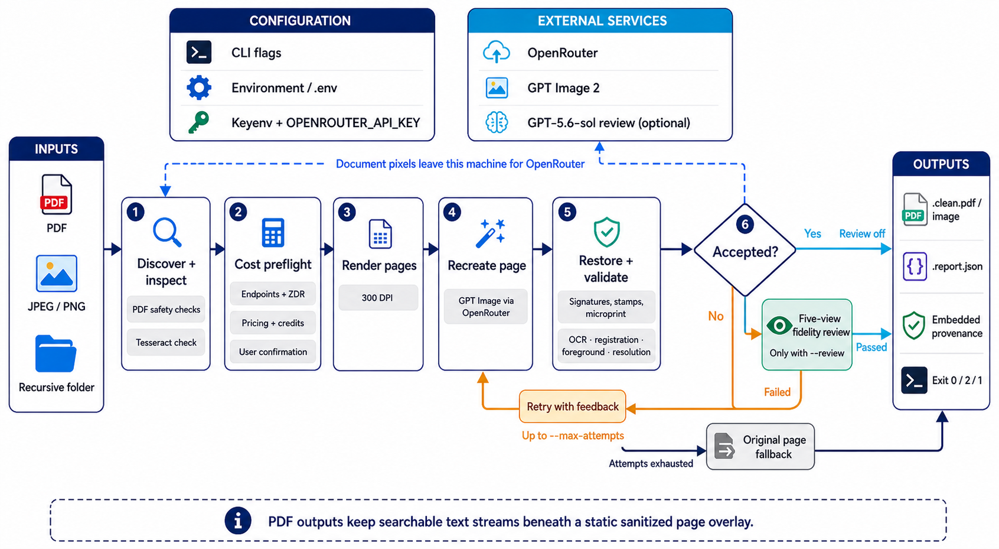

<p align="center">
  
  <br />
  <!-- repo-tagline:start -->
  <strong>🧹 Turn rough document photos into conservative, scanner-like files 🧹</strong>
  <!-- repo-tagline:end -->
</p>

PaperClean is a Python CLI for people who need cleaner PDFs or images from phone
photos and poor scans without silently accepting changed content. Give it a PDF,
JPEG, PNG, or folder; it recreates each page, runs local safety checks, requires
mandatory model verification, and falls back to the original page when a candidate
cannot be trusted.

Complete page pixels are sent to AgentBridge, which owns the selected model’s
provider credentials. Before work begins, PaperClean shows a preflight and asks
for confirmation. OpenRouter models include live cost and credit checks through
the gateway; Codex models show model-call ceilings because subscription USD usage
is not exposed. Every generated page must pass
local geometry and foreground checks plus five-view multimodal fidelity verification.

## Install

PaperClean requires Python 3.11 or newer:

```bash
uv tool install paperclean-cli
```

The PyPI distribution is named `paperclean-cli`; it installs the `paperclean`
command and Python package.

AgentBridge owns provider credentials. Use a local gateway configured to accept
requests without an application API key; PaperClean needs no gateway credential
for that setup. Authenticated agent use is blocked until a compatible native
sandboxed Infisical proxy route is separately reviewed and verified. This
repository does not provision that route. Never store a gateway token in a
plaintext file or supply a real key through raw environment injection.

Run PaperClean from the directory containing your document:

```bash
paperclean document.pdf
```

To run generation and mandatory verification through Codex instead, start the sibling
AgentBridge checkout and select the Codex models. No OpenRouter key is needed:

```bash
cd ../agentbridge
uv run agentbridge

# In another terminal, from the directory containing the document:
paperclean document.pdf --image-model codex/gpt-6.1-sol --review-model codex/gpt-6.1-sol --yes
```

## Document review workspace

Start AgentBridge, then launch the local workspace:

```bash
uv run --frozen paperclean-lab --port auto
# Optionally preload a document:
uv run --frozen paperclean-lab --port auto --import-document document.pdf
```

Upload a PDF, PNG, or JPEG, then restore the document. Navigate its pages to
compare the original and current restoration side by side. Numbered issue markers
show review descriptions on hover; click a marker for paired crops. **Accept issue**
includes a finding in the next repair; **Dismiss** marks a false alarm. Add comments
per finding or page instructions. Feedback saves automatically when leaving a
field or page, and can also be saved explicitly.

**Refine this page** repairs the selected page; **Refine marked pages** repairs
reviewed pages with accepted findings or comments. Each refinement uses the
latest page pixels, original evidence, and a frozen feedback snapshot, then
receives a new independent review. It creates a new document version while
retaining unchanged pages. Browse and download previous versions; refine from
the latest version. You can repeat this process without a fixed iteration limit.

Each generated or repaired page makes one native Codex imagegen request and one
structured review request to **GPT-6.1 Sol with High reasoning**. AgentBridge accepts
one image reference for generation, so repairs pack the original and prior
restoration into one labeled reference. The imagegen orchestrator field chooses
the Codex model calling the image tool; the underlying image model is not exposed.
Prompts remain editable. No OpenRouter key is used.

**Download full PDF** is available throughout processing. It includes every page,
using current candidate pixels, the prior restoration during an unfinished repair,
and original pixels where no restoration exists. Review markers are excluded.
Searchable text in source PDFs is preserved and active content is stripped.
The UI shows processing, failed, and partially restored versions explicitly.
Downloads are review candidates, not automatically accepted cleaned documents.

Originals, page versions, prompts, reviews, feedback, timing, and observable usage
persist in `tmp/paperclean-lab/` (ignored by Git); change this with `--data-dir`.

## Commands

```bash
paperclean document.pdf                         # clean one PDF
paperclean photo.jpg                            # clean one JPEG or PNG
paperclean scans/                               # recursively clean a directory
paperclean document.pdf --image-model codex/gpt-6.1-sol --review-model codex/gpt-6.1-sol   # use Codex through local AgentBridge
paperclean document.pdf --max-attempts 3        # set generation attempts per page
paperclean document.pdf --max-cost-usd 1.00     # set a soft observed-cost ceiling
paperclean document.pdf --review-model openai/gpt-5.6-sol  # select verifier
paperclean --help                               # show every CLI option
```

A source named `document.pdf` produces:

```text
document.clean.pdf
document.clean.pdf.report.json
```

Exit status `0` means every page passed, `2` means one or more original pages
were used, and `1` means a fatal file or batch failure.

## Configuration

CLI flags override environment variables, which override these defaults:

| Environment variable | Default |
| --- | --- |
| `AGENTBRIDGE_BASE_URL` | `http://127.0.0.1:8082/api/v1` |
| `PAPERCLEAN_AGENTBRIDGE_TIMEOUT` | `660` |
| `PAPERCLEAN_IMAGE_MODEL` | `openai/gpt-image-2` |
| `PAPERCLEAN_REVIEW_MODEL` | `openai/gpt-5.6-sol` |
| `PAPERCLEAN_MAX_ATTEMPTS` | `3` |
| `PAPERCLEAN_JOBS` | `1` |
| `PAPERCLEAN_MAX_COST_USD` | unset |
| `PAPERCLEAN_ZDR` | `false` |

`AGENTBRIDGE_API_KEY` is optional gateway authentication. The gateway owns upstream credentials.
Existing default OpenRouter image and review models are retained through AgentBridge.
Select `codex/gpt-6.1-sol` for both models to use subscription mode; that mode does
not support `--max-cost-usd` or `--zdr`. The CLI accepts optional gateway
authentication only from the process environment and ignores it in `.env` files.
For agent use, a separately reviewed native sandboxed proxy route must supply
its own configured placeholder through `AGENTBRIDGE_API_KEY`; no such route or
placeholder is configured by this repository. Until that review and verification,
use the local gateway without application authentication. Do not use raw secret
injection or another project's credentials as a fallback.

Non-secret settings are read from the repository `.env`, then
`~/.config/paperclean/.env`, then the process environment, with later sources
overriding earlier ones. The CLI does not read or relaunch legacy manifests.

## Notes

- Supported inputs are PDF, JPEG, and PNG. Directory traversal is recursive and
  does not follow directory symlinks.
- Local registration, foreground, canvas, and resolution checks run before mandatory
  five-view model verification. Rejected candidates retry with feedback, then fall
  back to a source-preserving white-paper cleanup that must pass the same verification.
  A page-scoped review timeout is retried exactly once before that attempt fails closed.
  That recovery confirms every rejection once. Confirmed scanner-quality failures still
  veto publication; only expected global deskew/layout rectification and conservatively
  preserved source uncertainty are tolerated. Explicit missing,
  cropped, invented, text, table, and diagram discrepancies still fail closed; localized
  normalized source evidence is restored for text-like discrepancies and the candidate is
  reviewed again. The untouched original page is used only if recovery still fails.
- PaperClean restores registered reviewer-identified text, tables, diagrams, layout,
  signatures, stamps, and edge content from cleaned source pixels without restoring
  stains, skew, shadows, or damaged edges. Large photographic and diagnostic-image
  panels and large shaded form regions remain pixel-exact while the surrounding scanned
  paper is cleaned, even when thin scan noise connects a panel to a page border. A binder
  hole and its halo are erased
  directly only when their surrounding context is blank. When a hole obscures
  authored ink, PaperClean attempts a localized model restoration only when the obscured
  continuation is highly probable and publishes it only after independent full-page and
  regional verification. Vague unresolved-content alerts reject assisted restoration;
  otherwise the original hole is retained instead of guessing.
  A `changed_diagram` review alert is tolerable only when the local detector confirms
  that large photographic panels were masked and preserved by this deterministic path.
- The cost preflight checks selected endpoints, live pricing, available credits,
  and the conservative recovery ceiling. `--yes` accepts the displayed
  preflight but never overrides insufficient known credits.
- Provider failures expose fixed public messages and recognized error codes in
  reports. Arbitrary upstream error text and billing details are withheld because
  they can contain credentials or document content.
- The AgentBridge preflight verifies Codex availability, authentication, native
  image generation, strict JSON Schema output, and both selected models. It shows
  conservative call counts and records observable orchestration tokens, but
  does not invent a USD cost or Codex subscription balance.
- `--max-cost-usd` is a soft ceiling. One completed request or an ambiguously
  billed timeout can exceed it.
- `--zdr` works only when every selected model endpoint is listed by OpenRouter
  as zero-data-retention capable. Do not process documents whose external
  transmission is prohibited.
- AgentBridge requests use `store: false`. Its strict Codex profile disables
  execution tools, treats page pixels as untrusted data, validates the returned
  raster, and removes request-scoped generated-image artifacts. Page pixels are
  still transmitted to the Codex service; do not process documents whose
  external transmission is prohibited.
- PDF outputs keep searchable text streams beneath an opaque page overlay.
  Active content and attachments are removed; encrypted PDFs, unapplied
  redactions, XFA, JavaScript-driven forms, and calculation-driven forms are
  rejected.

## Development

```bash
uv sync --frozen --all-groups   # install the locked development environment
uv run ruff check .             # lint
uv run mypy -p paperclean       # type-check
uv run pytest                   # run the offline test suite
uv build --no-sources           # build wheel and source distribution
uv run pytest -m live  # run opt-in live tests
```

Release workflow validation uses `python3 scripts/release.py --validate` to
check the exact pushed main commit without publishing. It builds the wheel and
source distribution, uploads and downloads them, audits their contents, and
smoke-tests the downloaded wheel in an isolated environment.

## Architecture



## AgentBridge routing

Model requests use only AgentBridge. Set `AGENTBRIDGE_BASE_URL` to its API root
(default `http://127.0.0.1:8082/api/v1`). `AGENTBRIDGE_API_KEY` is an optional
gateway token. OpenRouter credentials belong to AgentBridge. Existing model
choices are retained; raw upstream IDs gain `openrouter/` only on outbound
requests. There is no direct OpenRouter endpoint or fallback. Hosted deployments
must configure a reachable AgentBridge URL instead of the loopback default.

## License

MIT. See [LICENSE](LICENSE).
